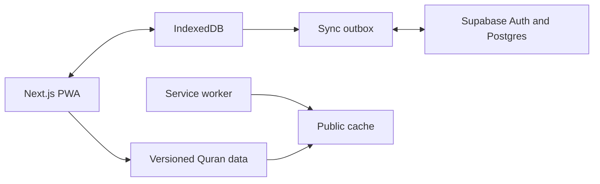

# Requirements

### Current status
No—the repository does not implement everything in the specification. It has a solid foundation: Bun workspaces/Turborepo, a Next.js App Router app, Supabase client factories and initial owner-scoped RLS tables, OpenNext/Wrangler configuration, CI checks, a PWA shell, and Quran corpus validation.

### Remaining launch scope
- Build the reader around user-selected QUL Uthmani text, QUL Surah names metadata (resource 70), Saheeh International translation, and English transliteration; retain accurate source/checksum attribution and disclose unknown rights status. Clearly signal that audio, tafsir, word-by-word study, and other resources are planned for future releases.
- Implement sign-in and usable profiles, bookmarks, notes, and reading progress.
- Add local-first offline reading and user-data storage/synchronization; the current service worker only handles the public shell/assets and has no IndexedDB data layer.
- Add attributed recitation/audio and study content, including tafsir and word-by-word translations.
- Complete installability and quality work, including the requested 192/512 PWA icon sizes and feature-level accessibility, performance, and browser validation.

### Scope boundary
This plan targets the web launch scope (roadmap Phases 1–5), completing the incomplete reader and personalization features while retaining the existing infrastructure. Prayer times, Qibla, duas, Hadith, Hifz/revision, analytics, and the future Expo app remain explicitly later expansion work. At the user's direction, proceed with QUL's selected Quran text despite its missing resource-level copyright/licence information; record that status as unknown, do not claim the content is public domain or licensed, and do not invent or alter Quran text.

# Technical Design

### Current implementation
- `package.json` and `turbo.json` define Bun workspaces and Turbo tasks; `apps/web/package.json` has Next.js, Tailwind, Supabase, Zod, OpenNext, and Wrangler dependencies.
- `apps/web/src/app/quran/page.tsx` is an integrity notice rather than a reader; the only current app routes are the landing page and `/quran`.
- `packages/quran-data/src/index.ts` validates source metadata, sequential numbering, 114 surahs, and 6,236 ayahs. The QUL Uthmani corpus is now versioned under `packages/quran-data/src/data/`, and the default validator verifies its source checksum.
- `supabase/migrations/20261124000000_initial_schema.sql` defines profiles, bookmarks, progress, notes, and owner-only RLS. `apps/web/src/lib/supabase/client.ts` and `server.ts` provide browser/server clients, but no auth or data workflows use them yet.
- `apps/web/public/sw.js` caches public assets and provides an offline fallback; `apps/web/src/app/manifest.ts` currently references a single SVG icon. `.github/workflows/ci.yml` already runs typecheck, lint, unit/e2e tests, build, and main-branch deployment.

### Key decisions
- Keep canonical Quran content version-controlled in `packages/quran-data`, independent of Supabase and Cloudflare. Use the user-selected QUL resource, recording source, edition, checksum, and the unavailable resource-level copyright/licence information accurately; never synthesize scripture or imply rights clearance.
- Keep translation and transliteration as separately attributed companion datasets, not canonical Arabic. Use the user-selected QUL Saheeh International simple translation and English Tajweed transliteration; record unknown resource-level rights accurately and make no redistribution-clearance claim.
- Keep QUL Surah names metadata as a separate, validated navigation dataset with its own source URL, checksum, and unknown rights status; do not merge it into canonical ayah text.
- Use the selected local-first model for personal data: IndexedDB is the immediate read/write store, with an idempotent outbox syncing authenticated changes to Supabase when connectivity returns. Use deterministic conflict rules per record type and retain RLS as the server-side access boundary.
- Keep the service worker limited to public static assets and Quran content. Never cache authenticated or private responses in its shared cache.
- Extend the existing App Router, workspace-package, Zod validation, Vitest, Playwright, and Supabase migration patterns rather than introducing a second app architecture.

### Architecture diagram

# Testing

### Validation approach
- Extend Vitest coverage for corpus provenance/integrity, reader data access, IndexedDB persistence, and idempotent offline synchronization.
- Exercise Supabase migrations and RLS with users attempting to read or mutate another user's rows; verify signed-out behavior and owner-only access.
- Extend Playwright flows for surah reading/search, authentication and personal features, offline reading and queued edits, and service-worker behavior. Confirm the worker never stores private responses.
- Use the existing CI workflow in `.github/workflows/ci.yml` for typecheck, lint, unit and end-to-end tests, and build; add checks only where new workflows require them.

# Delivery Steps

### ✓ Step 1: Integrate user-selected QUL Quran text and complete the data package
The versioned Quran package contains the user-selected QUL text with validated structure, accurate provenance, and an explicit record that the resource-level copyright/licence information is unavailable.

- Obtain QUL's selected Uthmani resource and record its source, edition, URL, checksum, verification date, and copyright/licence status as unavailable (not as a licence).
- Add the corpus and any surah/Juz metadata under `packages/quran-data/src/`; extend `packages/quran-data/src/index.ts` schemas only as needed for validated metadata and translations.
- Use `scripts/validate-quran-data.ts` and `scripts/generate-quran-index.ts` to validate and derive indexes; add Vitest cases for missing surahs/ayahs, source metadata, and checksum mismatch.
- Preserve the source text verbatim; document the unresolved rights status and do not represent it as cleared for redistribution.

### ✓ Step 2: Build Quran reading and discovery flows
Users can browse QUL surahs using source-attributed Arabic/transliterated names, navigate ayahs, search, and choose reading preferences, Saheeh International translation, and English transliteration. The interface clearly presents additional planned resources as forthcoming without implying they are already available.

- Replace the placeholder in `apps/web/src/app/quran/page.tsx` with the surah index and add the dynamic surah route plus `/search` and `/settings` under `apps/web/src/app/`.
- Add focused reader/navigation/search components under `apps/web/src/components/quran/`; load content through `@muslim-ayat/quran-data` and keep canonical text read-only.
- Implement continuous and Mushaf-style reading modes, ayah navigation, Arabic/translation/transliteration visibility controls, and persisted reading preferences; display source attribution and rights-status notices for companion content.
- Import and validate QUL Surah names metadata resource 70, including expected numbering and ayah counts, and display its attribution and unknown rights status.
- Add a restrained “planned for future releases” section for recitation/audio, tafsir, word-by-word study, and other roadmap resources, without promising a release date.
- Add Vitest coverage for content selection and navigation, and Playwright coverage for surah browsing, search, and preference changes.

### ✓ Step 3: Implement Supabase authentication and personal features
Signed-in users can manage their own profiles, bookmarks, notes, and reading position through the existing Supabase schema.

- Add sign-in/sign-out and session-aware routes/components using `apps/web/src/lib/supabase/client.ts` and `server.ts`.
- Add repository/actions for profiles, bookmarks, notes, and reading progress; validate shared inputs with Zod and `packages/shared` schemas.
- Extend `supabase/migrations/` only for required constraints or triggers, preserving the existing owner-scoped RLS policies and generated database contract in `packages/database/src/index.ts`.
- Add tests for signed-out access, CRUD behavior, and cross-user RLS denial; connect the bookmarks and account screens to the reader.

### ✓ Step 4: Add local-first offline reading and data synchronization
The reader remains usable offline, and personal changes made offline synchronize safely after connectivity returns.

- Add an IndexedDB-backed repository for public Quran content, bookmarks, notes, and reading progress; define a durable outbox and idempotent sync operations.
- Synchronize local records with Supabase only for an authenticated owner, using explicit conflict rules for bookmarks, notes, and the latest reading position.
- Extend `apps/web/public/sw.js` to cache validated public Quran assets and shell resources while continuing to bypass private/authenticated responses; preserve the offline fallback.
- Add tests for offline writes, reconnect/retry, duplicate sync, conflict handling, user switching, and prevention of private service-worker caching; add Playwright offline scenarios.

### ✓ Step 5: Add attributed audio and study content
Users can access source-attributed recitation and study aids without conflating them with canonical Quran text.

- Add validated data contracts and source/licence metadata for translations, tafsir, word-by-word glosses, reciters, and audio references.
- Add audio and study components under `apps/web/src/components/audio/` and `apps/web/src/components/quran/` for reciter selection, ayah playback, repeat, and playback speed.
- Respect `NEXT_PUBLIC_ENABLE_AUDIO` and provide clear unavailable/offline states; keep optional audio downloads user-initiated.
- Add tests for attribution display, playback controls, feature-flag behavior, and invalid or unavailable media references.

### ✓ Step 6: Harden PWA installability and launch quality
The web launch meets the specified installability, accessibility, and CI validation expectations.

- Add the requested 192px and 512px app icons and update `apps/web/src/app/manifest.ts` with appropriate install metadata and icon purposes.
- Review responsive reader behavior, keyboard navigation, screen-reader labels, Arabic text rendering, performance, and metadata/SEO across the main routes.
- Expand Playwright checks for install manifest/service-worker behavior and representative desktop/mobile layouts; keep Vitest, RLS, lint, typecheck, and build checks in CI.
- Document required production environment values, content review requirements, and free-tier limits without promising unlimited or uninterrupted free service.