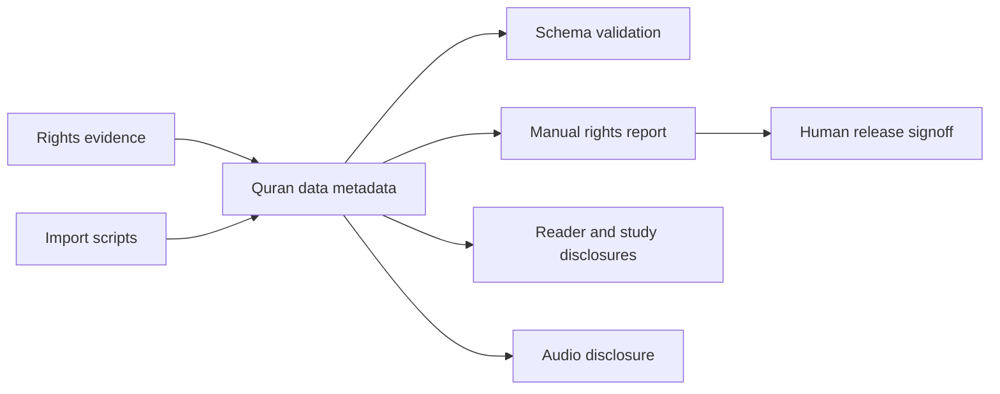

# Requirements

### Overview & Goals
Plan the first P0 implementation from the reuse audit: make Quran-content rights decisions explicit, traceable, and visible, then use them in a human-operated release review.

### Scope
- Cover the Arabic corpus, translation, transliteration, tafsir, word-by-word glosses, Surah metadata/header artwork, and recitation audio.
- Record rights evidence and use-specific permissions in Muslim Ayat’s existing Quran-data boundaries; unknown remains unknown and is never inferred from availability, checksums, or a source listing.
- Generate a report from that metadata and require human release signoff. Legal/rightsholder and qualified scholarly review are external prerequisites; implementation must not claim to resolve rights itself.
- Preserve guest access, authentication behavior, feature flags, database schema, existing stack, and public reading/search/listening/study routes. Do not copy reference-project code or datasets.
- Do not add a CI rights-status blocker. A report and human signoff are the selected release-control approach.

### Acceptance Criteria
- Every listed resource has explicit rights-review state, evidence/attribution information, and separate permissions for relevant uses such as public display, redistribution, offline caching, and commercial use.
- Unresolved permissions are clearly reported and are not represented as cleared; release readiness requires a human decision based on evidence.
- Reader disclosures distinguish rights status and applicable attribution from technical source integrity.
- No changes are made to auth, guest access, feature-flag defaults, database schema, or CI deployment gating.

# Technical Design

### Current Implementation
`packages/quran-data/src/index.ts` defines strict `QuranSourceSchema` metadata with source, edition, optional attribution note, nullable license, `rightsStatus` (`unknown`/`verified`), URL, checksum, and `verifiedAt`. The current `verifiedAt` is associated with imported source/checksum metadata and must not be reused as a legal-review timestamp. `packages/quran-data/src/audio.ts` separately models externally streamed audio with rights status fixed to `unknown`.

`packages/quran-data/src/reader.ts#getContentSources()` assembles corpus, companion, Surah metadata/header, tafsir, and gloss sources; audio is separate. `apps/web/src/components/quran/ContentSources.tsx` and `StudyAid.tsx` display source/rights status, while `apps/web/src/components/audio/AyahAudioPlayer.tsx` describes external streaming. Import scripts (`scripts/import-qul-quran-data.ts`, `scripts/import-qul-companions.ts`, and `scripts/import-qul-study.ts`) construct metadata directly, so they must preserve any expanded rights records. `scripts/validate-quran-data.ts` currently validates corpus structure and source checksum; `.github/workflows/ci.yml` does not enforce rights status.

### Key Decisions
- Keep `packages/quran-data` as the single source of truth; do not maintain a second independently edited rights register.
- Add a shared, typed rights-review record with independent permission states for relevant uses, rightsholder/edition, evidence or terms reference, attribution requirements, reviewer role, and a distinct review date. Keep `unknown` as the safe default and distinguish a reviewed restriction from a grant of permission.
- Use a metadata-driven, report-only command and a documented human release signoff. Do not fail CI or automatically change current feature availability based on unresolved status.
- Do not assert or populate legal conclusions without external evidence and appropriate legal/rightsholder and scholarly review.

### Proposed Changes
Extend the existing Quran-data contracts and audio metadata; update every affected importer and source record so regeneration does not erase review information. Include audio in the common content-source inventory while preserving recording/performance and provider terms as separately reviewable where applicable. Update public source, study, and audio disclosures to show evidence-backed attribution and per-use status, with an explicit unresolved state. Add a deterministic report command that enumerates every resource and unresolved permission, plus a short human signoff procedure; malformed metadata can fail validation, but `unknown` rights alone do not create an automated CI blocker.

### Architecture Diagram

### Data Models / Contracts
A resource rights record should represent: review state; rights holder and exact edition; evidence/terms reference; required attribution; review date and reviewer role; and permission state (`unknown`, `permitted`, or `not-permitted`) per relevant use. Keep this separate from source checksum and corpus-integrity metadata. Audio records must retain both provider/stream terms and recording/performance rights where their sources differ.

### File Structure
- Update `packages/quran-data/src/index.ts`, `packages/quran-data/src/audio.ts`, and `packages/quran-data/src/reader.ts`.
- Update source records in `packages/quran-data/src/data/quran.json`, `companions.json`, `surah-metadata.json`, `surah-header-source.json`, `tafsir-source.json`, and `word-by-word-source.json`; preserve unknowns pending evidence.
- Update metadata-producing importers: `scripts/import-qul-quran-data.ts`, `scripts/import-qul-companions.ts`, `scripts/import-qul-study.ts`, and the Surah metadata/header importers as applicable.
- Update `apps/web/src/components/quran/ContentSources.tsx`, `StudyAid.tsx`, and `apps/web/src/components/audio/AyahAudioPlayer.tsx`.
- Add a report-only script under `scripts/`, expose its command in root `package.json`, and document the manual review/signoff procedure in `docs/CONTENT_RIGHTS_REVIEW.md`.
- Extend the existing Quran-data and web component tests. Do not modify Supabase migrations or add a CI rights blocker.

### Risks
- Rights facts cannot be established by schemas or source availability; external review is mandatory, and unresolved resources remain unresolved until evidence is recorded.
- Because signoff is manual and not enforced by CI, a reviewer can miss or skip the process; the report must be repeatable and the procedure explicit.
- Import scripts can overwrite metadata unless rights fields are deliberately preserved. Existing content and guest availability must not be silently changed during this documentation/metadata phase.

# Testing

### Validation Approach
- Test each accepted and rejected rights-record shape, including missing evidence, unknown permissions, a reviewed-but-restricted resource, and distinct integrity versus rights-review timestamps.
- Verify all current resource categories—including audio—appear exactly once in the metadata-driven report and unresolved permissions are visible without falsely marking resources cleared.
- Verify importers preserve reviewed metadata while refreshing source checksums and do not infer permissions.
- Verify `ContentSources`, `StudyAid`, and audio disclosures render attribution, evidence links, and unresolved/permitted/restricted states accessibly.
- Run Quran-data unit tests, `bun run validate:quran-data`, the report command, web component/E2E tests, typecheck, lint, and build as applicable. Do not claim legal or scholarly review is testable by the AI agent; it requires human evidence review.

# Delivery Steps

### ✓ Step 1: Add shared rights metadata to Quran resources and importers
Quran resource and audio records carry explicit, use-specific rights review data without confusing it with source integrity.

- Extend the strict contracts in `packages/quran-data/src/index.ts` and `packages/quran-data/src/audio.ts` with review evidence, attribution, reviewer/date, and per-use permission states.
- Update current source records for Quran text, companions, Surah metadata/header art, tafsir, glosses, and audio; retain `unknown` wherever no external evidence has been approved.
- Update `scripts/import-qul-quran-data.ts`, `scripts/import-qul-companions.ts`, `scripts/import-qul-study.ts`, and applicable Surah importers so future imports preserve rights decisions while recalculating checksums separately.
- Add schema and importer tests covering unknown, permitted, restricted, missing-evidence, and checksum/review timestamp separation.

### ✓ Step 2: Expose consistent rights and provenance in reader surfaces
Public Quran, study, and audio surfaces display the rights and attribution details from the same resource metadata.

- Extend `packages/quran-data/src/reader.ts#getContentSources()` to include audio and consistently expose all current content categories.
- Update `apps/web/src/components/quran/ContentSources.tsx`, `StudyAid.tsx`, and `apps/web/src/components/audio/AyahAudioPlayer.tsx` to show status, applicable permissions, attribution, and evidence/source links.
- Keep unresolved status explicit and preserve current guest-reading, search, study, and listening access behavior; do not change auth, flags, or data caching.
- Add component tests for unknown, permitted, and restricted display states, including accessible labels and links.

### ✓ Step 3: Add report-driven human rights release signoff
A deterministic rights report and documented human review procedure cover all shipped resource records without introducing a CI rights blocker.

- Add a report-only script under `scripts/` and a root `package.json` command that enumerates resources and flags missing evidence or unresolved use permissions.
- Add `docs/CONTENT_RIGHTS_REVIEW.md` describing evidence requirements, attribution checks, reviewer/date recording, and the manual release signoff decision; keep resource metadata as the sole source of truth.
- Keep `.github/workflows/ci.yml` free of rights-status deployment blocking, consistent with the selected manual-review model.
- Test report determinism, complete resource coverage, unresolved-status visibility, and failure on malformed metadata while allowing valid `unknown` records to remain reportable.
- Mark actual clearance as pending external legal/rightsholder and qualified scholarly review; do not manufacture approvals or claim release readiness from code checks.