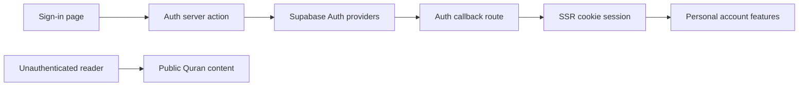

# Requirements

### Overview & Goals
Replace email/password authentication with Google, Microsoft, and Facebook sign-in through Supabase Auth for the initial launch. Account sign-in remains optional and exists for personalization and cross-device sync.

### Functional Requirements
- Offer only Google, Microsoft, and Facebook as sign-in methods; remove email/password sign-in and sign-up from the user interface and server actions. Do not add email OTP or magic-link authentication.
- Keep Quran reading and public content available without an account. Continue requiring a Supabase session for personal saves and synchronized data.
- A returning user must be able to access the same account on another device by using the same provider identity.
- Keep account linking out of this release; do not merge identities solely because two providers return the same email address.
- Show a clear sign-in error for failed, cancelled, or misconfigured OAuth flows, and handle an absent provider email without breaking the account page.

### Scope
- **In scope:** provider buttons, server-side OAuth initiation, callback/session handling, removal of email-only validation and flows, and setup documentation for enabling OAuth providers and redirect URLs.
- **Out of scope:** custom passwords, email OTP/magic links, account linking or account merging, changes to personal-data storage, and changes to RLS policies.

# Technical Design

### Current Implementation
`apps/web/src/app/sign-in/page.tsx` currently renders email/password sign-in and account creation forms. `apps/web/src/app/actions/auth.ts` validates credentials with `AuthCredentialsSchema` from `packages/shared/src/index.ts`, handles sign-up confirmation, and signs users out. `apps/web/src/app/auth/callback/route.ts` exchanges an auth code using the SSR client. `apps/web/src/lib/supabase/server.ts` persists Supabase sessions through Next.js cookies, while `apps/web/src/lib/supabase/require-user.ts` and database RLS protect personal data. `README.md` documents guest reading and currently describes email authentication; `supabase/config.toml` sets local site and callback URLs but does not contain provider credentials.

### Key Decisions
- Initiate OAuth from server actions in `apps/web/src/app/actions/auth.ts`, following the existing server-action and SSR-cookie conventions; keep one callback route to exchange the code and establish the session.
- Allow only the three requested Supabase providers (`google`, `azure` for Microsoft, and `facebook`) in the server action. Keep OAuth client secrets in Supabase provider configuration or environment-backed local Supabase settings, never in browser code or committed files.
- Preserve the existing public-content/personal-data boundary and owner-scoped authorization. Authentication-provider changes must not alter user IDs, personal-data ownership, or RLS.
- Defer account linking. Provider identity and verified-email behavior remain governed by Supabase Auth; application code must not infer identity equivalence from matching email strings.

### Proposed Changes
Replace the two email forms with clearly labeled provider sign-in controls. The server action validates the provider against the allowlist, calls Supabase OAuth with the app callback URL, and redirects to the provider URL. The callback exchanges the returned code, then redirects successful sign-ins to `/account`; errors and cancellations return to `/sign-in` with a user-safe status. Remove the now-unused email credentials schema and its type/test. Update account identity presentation for users whose provider does not supply an email, and revise setup documentation to describe enabling the providers, registering provider callback URLs, and configuring the app's Supabase redirect allowlist.

### Architecture Diagram

### File Structure
- Modify `apps/web/src/app/sign-in/page.tsx` for provider controls and OAuth feedback.
- Modify `apps/web/src/app/actions/auth.ts` for provider allowlisting, OAuth initiation, and removal of email sign-in/sign-up actions.
- Modify `apps/web/src/app/auth/callback/route.ts` for successful OAuth code exchange and safe failure/cancellation handling.
- Modify `apps/web/src/app/account/page.tsx` to render account identity safely when email is unavailable.
- Modify `packages/shared/src/index.ts` and `packages/shared/src/index.test.ts` to remove email-only `AuthCredentialsSchema` exports and assertions.
- Modify `README.md` to replace email-auth setup instructions with social-provider configuration guidance; keep credentials external to version control.

### Risks
Provider OAuth client IDs/secrets and production redirect allowlists must be configured outside this code change; without them, real provider handshakes cannot succeed. Provider cancellation, absent email claims, and unsupported provider values must not produce an unintended sign-in or account association.

# Testing

### Validation Approach
- Add or update tests for the provider allowlist, OAuth redirect construction, callback success/failure routing, and account identity rendering where practical using the existing Vitest setup.
- Verify the sign-in page presents only Google, Microsoft, and Facebook, and the shared package no longer exposes the email credentials schema.
- Run the web and shared-package tests, typecheck, lint, and production build. Keep the existing Supabase RLS tests unchanged and verify public reader routes still work while signed out.
- Use mocked provider responses for agent-testable OAuth behavior; live provider handshakes require configured Supabase and provider credentials and are not assumed in CI.

# Delivery Steps

### ✓ Step 1: Replace email sign-in UI and contracts
The sign-in page no longer exposes email/password authentication, and email-only credential validation is removed.
- Replace the email sign-in and account-creation forms in `apps/web/src/app/sign-in/page.tsx` with the three requested provider controls and clear OAuth status messaging.
- Remove email sign-in and sign-up actions and confirmation-only handling from `apps/web/src/app/actions/auth.ts`, retaining sign-out.
- Remove `AuthCredentialsSchema` and its type from `packages/shared/src/index.ts`, plus email-credential assertions from `packages/shared/src/index.test.ts`.
- Add/update checks confirming the page offers only the selected methods and the removed schema is no longer exported.

### ✓ Step 2: Implement Supabase OAuth initiation and callback
Google, Microsoft, and Facebook sign-in use a validated server-action redirect and establish the existing SSR Supabase session on callback.
- Add a strict provider allowlist in `apps/web/src/app/actions/auth.ts` and initiate OAuth through the existing server Supabase client, redirecting to the generated provider URL.
- Update `apps/web/src/app/auth/callback/route.ts` to exchange valid codes, route successful sessions to `/account`, and return safe errors for rejected or cancelled flows.
- Preserve cookie-based session handling from `apps/web/src/lib/supabase/server.ts` and existing `requireUser`/RLS ownership behavior.
- Add mocked tests for accepted and rejected providers, OAuth redirect configuration, and callback success/failure paths.

### ✓ Step 3: Preserve guest and account behavior and document setup
Guest Quran access remains public, provider account identity is displayed safely, and operators have clear instructions for configuring the three OAuth providers.
- Update `apps/web/src/app/account/page.tsx` to handle a null email claim without displaying a blank or broken account identity.
- Update `README.md` to document Supabase Google, Microsoft, and Facebook provider setup, OAuth callback/redirect allowlists, and the fact that provider credentials stay outside the repository.
- Confirm public Quran routes remain usable signed out and personal-data actions remain session- and RLS-protected.
- Run relevant Vitest suites, typecheck, lint, and production build; retain the existing RLS tests as the authorization regression check.